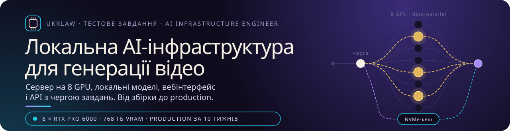
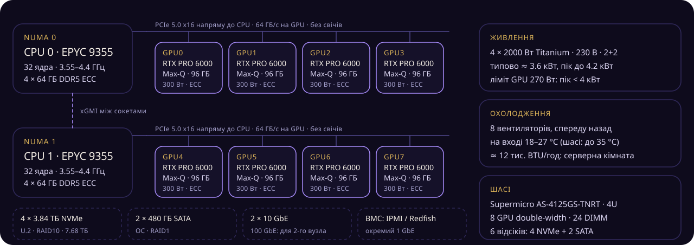
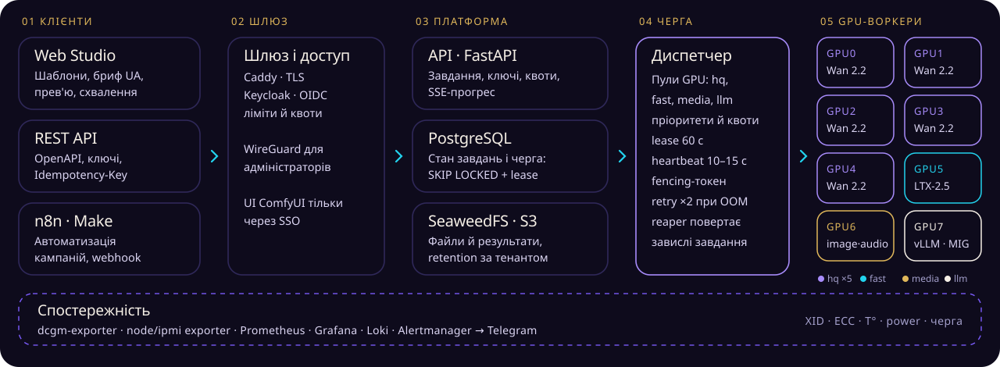
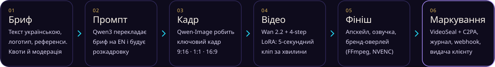
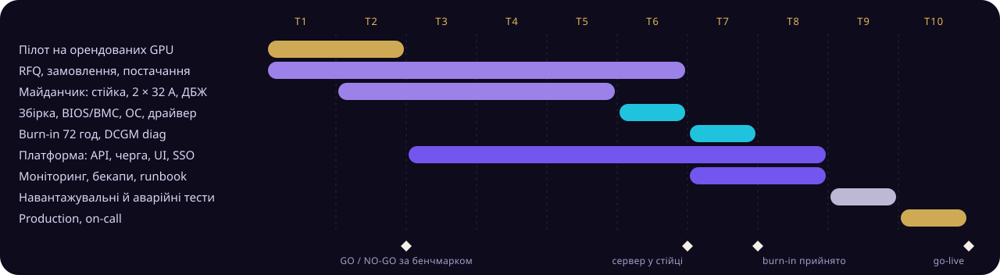

<div align="center" class="banner">



<!-- print:skip:start -->
[](#11-специфікація-і-бюджет)
[](#14-multi-gpu-і-масштабування)
[](#22-системний-стек)
[](#22-системний-стек)
[](#22-системний-стек)
[](#22-системний-стек)
[](https://github.com/bogdan734/ukrlaw-ai-infra/actions/workflows/ci.yml)
[](LICENSE)
<!-- print:skip:end -->

</div>

**Технічне рішення для UKRLAW** · Богдан Гаврилюк · 26.10.2026 · ціни й версії станом на цю дату · [PDF, 5 сторінок](docs/UKRLAW-AI-Infrastructure.pdf)

## 📌 Коротко

| Що | Рішення |
|---|---|
| **Сервер** | 1 вузол 4U: 8 × NVIDIA RTX PRO 6000 Blackwell Max-Q (768 ГБ VRAM), 2 × AMD EPYC 9355, 512 ГБ DDR5, 7.7 ТБ NVMe |
| **Продуктивність** | ≈ 20–30 кліпів 720p × 5 с на годину на GPU (Wan 2.2 + 4-step LoRA): 100–150 на пулі hq (5 GPU), до 160–240 на всіх восьми. Оцінка від виміряних 656 с на кліп при 20 кроках (600-ватна версія) |
| **Бюджет** | CAPEX ≈ $194 тис. ($170–220 тис.), OPEX ≈ $1.6 тис./міс. Варіанти: $140 тис. (RTX PRO 5000) і 4 + 4 GPU ($130 + $64 тис.) |
| **Моделі** | Wan 2.2 (основна), LTX-2.5 (звук, чернетки), Qwen-Image і Z-Image (кадри), SeedVR2 (апскейл), Qwen3 (промпти, модерація) |
| **Платформа** | Web Studio, REST API, черга на PostgreSQL, ComfyUI-воркер на кожен GPU, моніторинг DCGM + Prometheus |
| **Запуск** | 10 тижнів до production, якщо GPU є на складі. Перші 2 тижні: пілот на орендованих GPU |
| **Висновок** | Власний сервер дешевший за оренду за завантаження понад 50–70%. До цього: пілот на оренді й закупівля 4 + 4 GPU |

<!-- print:skip:start -->
## 🗂 Зміст

- [Відповідність вимогам ТЗ](#-відповідність-вимогам-тз)
- [1. Архітектура інфраструктури](#1-архітектура-інфраструктури): [специфікація і бюджет](#11-специфікація-і-бюджет) · [обґрунтування](#12-чому-саме-так) · [відхилені варіанти](#13-відхилені-варіанти) · [Multi-GPU](#14-multi-gpu-і-масштабування)
- [2. AI-стек і розгортання](#2-ai-стек-і-розгортання): [моделі](#21-моделі) · [системний стек](#22-системний-стек) · [платформа](#23-платформа-вебінтерфейс-api-черга) · [оптимізація](#24-оптимізація-інференсу)
- [3. План запуску](#3-план-запуску): [етапи](#31-етапи) · [моніторинг](#32-моніторинг-і-стабільність) · [ризики](#33-ризики) · [окупність](#34-окупність)
- [Досвід і референси](#-досвід-і-референси) · [Джерела](#-джерела)
<!-- print:skip:end -->

## ✅ Відповідність вимогам ТЗ

| Вимога ТЗ | Де | Вимога ТЗ | Де |
|---|---|---|---|
| Сервер, компоненти, бюджет | [1.1](#11-специфікація-і-бюджет) | Linux, драйвер, CUDA, PyTorch, Docker | [2.2](#22-системний-стек) |
| Обґрунтування GPU, VRAM, CPU, PCIe, RAM, дисків, живлення, охолодження | [1.2](#12-чому-саме-так), [1.3](#13-відхилені-варіанти) | Вебінтерфейс, API, черга | [2.3](#23-платформа-вебінтерфейс-api-черга) |
| Multi-GPU і масштабування | [1.4](#14-multi-gpu-і-масштабування) | Етапи запуску до production | [3.1](#31-етапи) |
| AI-моделі для відео | [2.1](#21-моделі) | Моніторинг GPU, стабільності, продуктивності | [3.2](#32-моніторинг-і-стабільність) |
| Ризики й способи усунення | [3.3](#33-ризики) | Посилання на попередні проєкти | [Досвід](#-досвід-і-референси) |

## 1. Архітектура інфраструктури

### 1.1 Специфікація і бюджет

| № | Компонент | Модель / специфікація | Шт. | $/шт. | Разом, $ |
|---|---|---|---|---|---|
| 1 | GPU | NVIDIA RTX PRO 6000 Blackwell Max-Q, 96 ГБ GDDR7 ECC, 300 Вт | 8 | 16 000 | 128 000 |
| 2 | Сервер | Supermicro AS-4125GS-TNRT: 4U, плата H13DSG-O-CPU rev. 2.x, 4 × 2000 Вт Titanium, 8 вентиляторів | 1 | 9 000 | 9 000 |
| 3 | CPU | AMD EPYC 9355: 32 ядра, 3.55–4.4 ГГц, 280 Вт | 2 | 3 700 | 7 400 |
| 4 | RAM | DDR5 ECC RDIMM 64 ГБ (DDR5-6000+), по 4 модулі на сокет | 8 | 2 400 | 19 200 |
| 5 | NVMe | 3.84 ТБ U.2, ≥ 1 DWPD (Samsung PM9A3, Micron 7500 PRO або Kioxia CM7-R) ‡ | 4 | 1 600 | 6 400 |
| 6 | SATA | 480 ГБ enterprise SSD (Micron 5400 PRO або Samsung PM893) ‡ | 2 | 250 | 500 |
| 7 | Живлення | ДБЖ online 10 кВА, 230 В, і 2 × PDU 32 А (власна серверна) ‡ | 1 | 9 000 | 9 000 |
| 8 | Стійка | 42U, рейки, кабелі (власна серверна) ‡ | 1 | 2 000 | 2 000 |
| 9 | Підтримка | 3 роки NBD на сервер і ЗІП (БЖ, вентилятори, DIMM) ‡ | | | 12 000 |
| | **Разом** | | | | **193 500** |

<sub>Ціни без ПДВ на 26.10.2026. Ринкові: GPU $15 999.99 (Central Computer), EPYC 9355 $3 694 (прайс AMD), 64 ГБ DDR5 $2.4–3.4 тис. за модуль, barebone-шасі $6.9–8.5 тис. ‡ оцінка до комерційних пропозицій. GPU +87% від MSRP ($8 565 у 2025); TrendForce очікує у 4К26 ще +10–15% для DRAM і +15–20% для NAND, тому ціни RAM і SSD фіксуємо в пропозиції. У колокації ДБЖ, стійку й генератор надає майданчик: рядки 7–8 зникають (−$11 тис.), але росте OPEX. Для другого вузла додаються комутатор і NIC 100 GbE.</sub>

**Варіанти.** B: 8 × RTX PRO 5000 72 ГБ ($9–9.6 тис., 300 Вт) дає ≈ **$140 тис.** і ≈ 59% обчислень Max-Q (72 ГБ вимагають fp8). C: 4 + 4 GPU, ≈ **$130 тис.** зараз і $64 тис. згодом, коли завантаження підтвердить потребу. Те саме шасі, ті самі воркери.

### 1.2 Чому саме так

| Компонент | Вибір | Обґрунтування |
|---|---|---|
| GPU | RTX PRO 6000 Blackwell **Max-Q** | 96 ГБ тримають обидва експерти Wan 2.2 A14B у bf16 (≈ 64 ГБ) без offload. Blackwell дає FP8 і NVFP4 (у Hopper FP4 немає), є ECC, драйвер не під обмеженнями GeForce. Max-Q: 300 Вт і 87% BF16 від 600-ватної версії (439 проти 504 TFLOPS), є в списку підтримки шасі, 8 × 300 Вт лишають БЖ у режимі 3+1. На Wan 2.2 швидша за H100 PCIe/NVL: 734 с (600 Вт; для Max-Q закладаємо +10–20%) проти 1059–1071 с |
| VRAM | 8 × 96 = 768 ГБ | Wan 2.2 A14B у bf16: 2 експерти × 28 ГБ + umT5 ≈ 11 ГБ + VAE й активації 720p вміщаються у 96 ГБ без offload; на 72 ГБ потрібен fp8 (≈ 35 ГБ). На 24–32 ГБ fp8 і offload: RTX 5090 дає 1297 с проти 734 с |
| CPU | 2 × EPYC 9355 | 8 слотів x16 підключено до CPU напряму, без PCIe-свічів. 32 ядра на сокет вистачає на 8 воркерів, FFmpeg, PostgreSQL і vLLM. Дешевший за Xeon 6737P на 34% ($3 694 проти $5 594). На Xeon повідомляли про низьку P2P-швидкість між RTX PRO 6000 (Level1Techs) |
| PCIe | Gen5 x16 на кожен GPU | 64 ГБ/с у кожен бік. P2P працює: ≈ 53–56 ГБ/с у сокеті, 39–51 між сокетами (виміри спільноти, rtx6kpro). NVLink немає, тому дизайн не залежить від міжGPU-трафіку. Перевірка: `nvidia-smi topo -m`, nccl-tests, `iommu=pt` |
| RAM | 512 ГБ (8 × 64 ГБ) | Page cache моделей ≈ 100–150 ГБ, 8 процесів по ≈ 8 ГБ, vLLM, PostgreSQL. 4 канали з 12 на сокет (≈ 190 ГБ/с): модель обмежує NVMe (≈ 14 ГБ/с), не RAM. 16 слотів вільні (до 1.5 ТБ), донаселимо, коли ціни впадуть ($2.4–3.4 тис. за 64 ГБ) |
| Диски | 4 × 3.84 ТБ NVMe RAID10, ОС на 2 × SATA RAID1 | 7.7 ТБ: моделі ≈ 2 ТБ, результати за 90 днів ≈ 1.5 ТБ, scratch ≈ 1 ТБ. 1 DWPD із запасом (запис ≈ 100–300 ГБ/добу). Модель на 64 ГБ вантажиться за ≈ 5–10 с. Щоночі бекап restic у S3 або NAS |
| Живлення | 4 × 2000 Вт Titanium, 230 В | GPU 2.4 кВт + CPU 0.56 + вентилятори ≈ 0.25 + решта ≈ 0.3 = ≈ **3.6 кВт**, пік до 4.2 кВт (оцінка, замір при burn-in). Режим 2+2 дає 4 кВт на ввід (A/B), тому ліміт GPU 270 Вт (≈ −5% швидкості) тримає пік < 4 кВт; 3+1 (до 6 кВт) запасний, без резерву вводу. Вводи A/B від незалежних ДБЖ або ліній майданчика; ДБЖ на 5–10 хв для вимкнення через NUT, далі генератор |
| Охолодження | Повітря спереду назад, 18–27 °C на вході | ≈ 3.6 кВт тепла ≈ 12 тис. BTU/год. Шасі працює до 35 °C, але тротлінг GPU починається раніше. Вентилятори шумні: серверна кімната або колокація, не офіс |

### 1.3 Відхилені варіанти

| Варіант | Чому ні |
|---|---|
| 8 × RTX 5090 (32 ГБ) | Ліцензія GeForce забороняє datacenter deployment (§ 2.8) і commercial hosting (§ 2.7). 32 ГБ означає offload (1297 с проти 734 с). Немає ECC і офіційного P2P. Близько $5 тис. за карту ($156/ГБ проти $167/ГБ): за ціною різниця мала, вирішують ліцензія й ECC |
| RTX PRO 6000 Server Edition, 600 Вт | Немає в списку підтримки AS-4125GS-TNRT. 8 × 600 Вт = 4.8 кВт лише на GPU, близько до межі 6 кВт. Відомо про випадок, коли в шасі Supermicro потужність GPU обмежували до 450 Вт. +15% BF16 не варті ризику |
| H100 / H200 NVL | Повільніші на Wan 2.2 (PCIe 1059 с, NVL 1071 с проти 734 с) і дорожчі. HBM і NVLink не потрібні для job-per-GPU. Hopper без FP4: NVFP4-моделі для Blackwell на ньому не працюють |
| 10 GPU в одному корпусі | У шасі 8 double-width слотів. Більше GPU означає інший корпус і більший домен збою, тому краще другий вузол (див. 1.4) |

<p align="center" class="figure"><br><sub>Рис. 1. Топологія вузла: GPU підключені напряму до CPU. Джерело: сторінка шасі Supermicro AS-4125GS-TNRT.</sub></p>

### 1.4 Multi-GPU і масштабування

**Основний режим: одне завдання на один GPU.** Масштабування лінійне, збій одного GPU (XID) не зупиняє інших семи, NVLink не потрібен. Інші режими вмикаються за потреби:

| Режим | Як працює | Коли | Ефект |
|---|---|---|---|
| Job-per-GPU | ComfyUI-воркер на GPU, чергу розбирає диспетчер | 95% завдань | ≈ 20–30 кліпів/год на GPU (4-step) |
| Sequence parallel (Ulysses/USP, xDiT) | Кліп ділиться на 4 GPU одного сокета | «Hero»-рендер: 720p без дистиляції, далі апскейл до 1080p | Офіційно на H100: 3.6× на 4 GPU, 6.7× на 8. На PCIe очікуємо на 10–35% менше (оцінка) |
| Пули GPU | hq × 5 (Wan 2.2), fast × 1 (LTX-2.5), media × 1 (зображення, звук), llm × 1 | Завжди | Диспетчер переносить GPU між пулами за глибиною черги (крім GPU7 з MIG) |
| MIG | GPU7 → 2 × 48 ГБ для vLLM (Qwen3) і допоміжних сервісів | Малі сервіси | Ізоляція. Для відео не годиться: слайс 48 ГБ дає 1613 с проти 734 с |

**Топологія.** Воркер прив'язується до сокета свого GPU (`numactl`), multi-GPU завдання планується в межах сокета, топологію й P2P перевіряємо при прийманні. **Масштабування.** Шасі вміщує максимум 8 GPU, тому далі масштабуємося вузлами: другий сервер реєструє свої GPU в тому самому PostgreSQL, диспетчер видає завдання на обидва. PostgreSQL і сховище виносяться з вузла (Patroni, кластер SeaweedFS), для другого вузла додаються комутатор і NIC 100 GbE. Kubernetes (K3s, GPU Operator, Kueue) має сенс від трьох вузлів.

## 2. AI-стек і розгортання

### 2.1 Моделі

| Призначення | Модель | Чому | VRAM | Ліцензія |
|---|---|---|---|---|
| Текст і зображення у відео | **Wan 2.2 A14B** + 4-step LoRA (LightX2V), TI2V-5B для чернеток | Найкраща відкрита модель із чистою ліцензією: Wan 2.5–3.0 лише через API. Є LoRA, ComfyUI, дистиляція. 720p, 81 кадр | ≈ 64 ГБ bf16, ≈ 35 ГБ fp8 | Apache-2.0 |
| Відео зі звуком, до 4K | **LTX-2.5** (22B) | Найкраща відкрита модель без територіальних обмежень. Дистильована LTX-2.3: кліп 768×512 за 7.5 с на RTX PRO 6000 (Runpod) | ≈ 32 ГБ | Безкоштовно до $10 млн виручки групи |
| Персонажі, мовлення | Wan2.2-Animate-2-14B, Wan2.2-S2V-14B | Перенесення руху й lip-sync без окремого стеку | 20–64 ГБ | Apache-2.0 |
| Кадри, пакшоти | Qwen-Image-Edit-2511, Z-Image-Turbo, FLUX.2 klein 4B | FLUX.2 dev і klein 9B некомерційні: заблоковані | 13–40 ГБ | Apache-2.0 |
| Фініш | SeedVR2 (апскейл), RIFE (ліцензію перевірити), FFmpeg з NVENC | 480p плюс апскейл дешевший за нативний 1080p | від 8 ГБ | SeedVR2: Apache-2.0, FFmpeg: LGPL |
| Мова, промпти | Qwen3-30B-A3B (vLLM, fp8 ≈ 31 ГБ), Qwen3Guard, Whisper large-v3 (WER uk 6.5% на FLEURS), robinhad/ukrainian-tts | Переклад UA→EN, розкадровка, фільтр промптів, субтитри, озвучка | слайс 48 ГБ | Apache-2.0, MIT |
| Лише тест | MiniMax H3, HunyuanVideo 1.5, MAGI-2 | H3 і Hunyuan виключають ЄС і Британію (H3 ще США й Корею), MAGI-2 хоче 8 Hopper | | Не для клієнтів ЄС/США |

У production потрапляє лише модель із реєстру ліцензій (прапорець у БД): Apache/MIT, а LTX-2.5 за умовами ліцензії з щорічною перевіркою виручки групи.

### 2.2 Системний стек

| Шар | Вибір | Примітка |
|---|---|---|
| ОС | Ubuntu Server 24.04.4 LTS, ядро 6.17 (HWE) | У QA-таблиці NVIDIA. 26.04.1 вийшла 27.08.2026, але для x86 її там ще немає |
| Драйвер | NVIDIA **R580 LTSB**, open kernel modules, підтримка до 06.2028 | Open-модулі обов'язкові для Blackwell. R595 запасний, R615 (new-feature) не для production. `nvidia-persistenced`, ECC вмикаємо явно |
| CUDA | 13.0 у контейнерах, на хості лише драйвер | У CUDA 13.4 відомий баг cuBLASLt grouped GEMM на Blackwell |
| PyTorch | 2.14.x, колеса cu130, Python 3.12 | cu126 без kernels для Blackwell. 2.15 вийде 28.10, беремо після двох тижнів тестів |
| Контейнери | Docker Engine 29.8 + NVIDIA Container Toolkit 1.20 (CDI) | Образи на `nvidia/cuda`. FlashAttention і SageAttention збираємо самі: офіційних колес для sm_120 немає |
| Рушії | ComfyUI (GPL-3.0, headless API, пін комітів), LightX2V, vLLM, Diffusers | Кожному воркеру свій GPU (`device_ids`) і своя модель |
| Дані, доступ | PostgreSQL, SeaweedFS (S3), Caddy, Keycloak, WireGuard | MinIO заархівовано в квітні 2026, тому не беремо. ComfyUI лише за SSO |

### 2.3 Платформа: вебінтерфейс, API, черга

<p align="center" class="figure"><br><sub>Рис. 2. Платформа: клієнти → шлюз → API → черга в PostgreSQL → воркер на кожен GPU. Моніторинг збирає метрики з усіх рівнів.</sub></p>

**Web Studio** (Next.js): шаблони кампаній (рілс 9:16, сторіс, банер 1:1, ролик 16:9), бриф українською, перегляд, схвалення, версії. Бренд-кіт накладається детерміновано через FFmpeg, а не моделлю: текст і логотипи модель спотворює. Ролі: адмін, креатор, глядач; квоти — на команду. ComfyUI бачать лише технічні користувачі через SSO.

**API** (FastAPI, OpenAPI 3.1): `POST /v1/jobs` з `Idempotency-Key` повертає `202`; `GET /v1/jobs/{id}` віддає статус, прогрес, результати, таймінги; `DELETE` скасовує; SSE для прогресу; webhook з HMAC-підписом і повторами; API-ключі зі scope й квотами. n8n або Make підключаються через webhook.

```json
POST /v1/jobs     Idempotency-Key: 7c9e…
{ "workflow": "wan22_i2v_lightning@3", "priority": "batch",
  "inputs": { "prompt_uk": "Кава на світанку", "image": "s3://assets/product.png", "duration_s": 5, "aspect": "9:16" },
  "webhook": { "url": "https://crm.example/hook", "events": ["succeeded", "failed"] } }
→ 202 { "id": "job_01J…", "status": "queued", "queue_position": 3 }
```

**Черга** ([`deploy/queue`](deploy/queue): SQL і 9 тестів на PostgreSQL 16). PostgreSQL — це і стан, і черга (`SELECT … FOR UPDATE SKIP LOCKED` за пулом і пріоритетом). Агент на GPU бере завдання й запускає ComfyUI через локальний API. Кожні 10–15 с він продовжує lease (60 с) heartbeat-ом, орієнтуючись на прогрес із `/ws`.

- **Fencing-токен:** завершити завдання може лише власник актуального lease. Це закриває «зомбі-воркера», який нібито зник, але дописує результат (відомий випадок у Procrastinate, issue #1633).
- **Reaper** повертає завдання з простроченим lease. Для OOM і збою вузла — 2 повтори з деградацією параметрів (fp8, VAE tiling) або в іншому пулі, для помилок валідації — жодного. Жорсткий timeout на пул, окремий `start_deadline`.
- **Idempotency:** унікальна пара (tenant, ключ), повторний POST повертає те саме завдання. Той самий підхід (outbox, повтори з backoff, circuit breaker) реалізовано в [techcom-ai-ops](https://github.com/bogdan734/techcom-ai-ops).
- **Чому не Celery/Redis:** завдання довше за `visibility_timeout` виконується вдруге. У RabbitMQ типове значення `consumer_timeout` — 30 хв, а це верхня межа тривалості наших завдань. Temporal потім, для багатокрокових конвеєрів.

<p align="center" class="figure"><br><sub>Рис. 3. Конвеєр завдання: бриф → промпт і розкадровка (Qwen3) → ключовий кадр (Qwen-Image) → відео (Wan 2.2) → апскейл, озвучка, бренд-оверлей → маркування (VideoSeal, C2PA) → webhook. Кожен крок іде в чергу окремо, зі своїм пулом GPU.</sub></p>

**Маркування і право.** AI Act, ст. 50 діє з 02.08.2026, а добровільний Code of Practice (10.06.2026) описує два шари: підписані метадані (C2PA, c2pa-rs) і невидимий водяний знак (VideoSeal, MIT). В Україні результат без творчої участі людини захищає право sui generis на 25 років (Закон № 2811-IX), а зображення чи голос людини потребують письмової згоди (ст. 8 Закону про рекламу, ст. 307–308 ЦК). Тому в UI є поле consent ID, а журнал зберігає prompt, seed, модель, оператора й хеш.

### 2.4 Оптимізація інференсу

Базова лінія на RTX PRO 6000 600 Вт (ComfyUI, Wan 2.2, 1280×704, 81 кадр, 20 кроків): **734 с** у fp16, **656 с** у fp8; для Max-Q закладаємо +10–20%. Далі за впливом:

1. **Дистиляція кроків.** 4-step LoRA без CFG: 4 проходи DiT замість 40, до 10× (HunyuanVideo 1.5: ≈ 25× за даними LightX2V). Генерація кліпу скорочується з ≈ 12 до ≈ 2 хв.
2. **Квантизація Blackwell.** FP8 дає ≈ 1.5–2× на лінійних шарах. NVFP4-Sparse варіант Wan 2.2: понад 50× end-to-end проти 40 кроків на RTX 5090 (дані LightX2V, перевіряємо на Max-Q у пілоті).
3. **Увага.** На 720p це 72% FLOPs, тому SageAttention 2/3 і розріджена увага важливіші за NVFP4 на лінійних шарах.
4. **Резидентні моделі.** Завдання йде на GPU, де модель уже у VRAM. `torch.compile` з CUDA graphs, VAE tiling, кеш текстових ембедингів, 480p + SeedVR2 замість нативного 1080p, NVENC для кодування.

## 3. План запуску

### 3.1 Етапи

<p align="center" class="figure"><br><sub>Рис. 4. План на 10 тижнів. Постачання GPU йде паралельно з розробкою платформи.</sub></p>

| Етап | Що робимо | Критерій виходу |
|---|---|---|
| T1–2. Пілот | 8 × RTX PRO 6000 в оренді на 72 год (≈ $1–1.6 тис.), далі 1–2 GPU на час розробки (≈ $2 тис.): бенчмарк Wan 2.2 (fp8, 4-step, NVFP4, ліміт 300 Вт) і LTX-2.5, перевірка ліцензій | ≥ 20 кліпів/год на GPU, пік VRAM < 90 ГБ, GO/NO-GO |
| T1–6. Закупівля | RFQ у трьох дистриб'юторів з T1, замовлення в T3 після GO, письмова дата постачання GPU, фіксація цін RAM і SSD. Майданчик: стійка, 2 × 32 А, ДБЖ, генератор | Залізо на майданчику до кінця T5 |
| T6. Збірка | оновлення BIOS/BMC, плата rev. 2.x з підтримкою EPYC 9005, налаштування BIOS (Above-4G, Resizable BAR, IOMMU, NPS1), Ubuntu autoinstall + Ansible, драйвер, Docker | Усі 8 GPU видно, `nvidia-smi topo -m` збігається з Рис. 1 |
| T7. Burn-in 72 год | `dcgmi diag -r 4`, gpu-burn, nccl-tests, nvbandwidth, memtest86+, fio, перевірка детермінізму | 0 XID, 0 ECC DBE, T < 80 °C за 25 °C на вході, без тротлінгу |
| T3–8. Платформа | API, черга, UI, SSO, воркери, моніторинг, бекапи, runbook. Розробка на орендованому GPU | Золоте завдання проходить наскрізь |
| T9. Тести відмов | 1000 завдань (k6), kill воркера й ComfyUI, вимкнення БЖ і мережі, імітація відключення живлення | Жодного втраченого й жодного подвоєного завдання |
| T10. Production | SLO, on-call, DR: після програмних збоїв відновлення з Ansible й бекапу за < 4 год, після апаратних failover черги на орендовані GPU. Спочатку 3–5 користувачів | go-live |

10 тижнів реальні, якщо GPU є на складі. Інакше (у березні 2026 постачання сягало 3–7 місяців) пілот на оренді триває, а GPU купуємо 4 + 4.

### 3.2 Моніторинг і стабільність

| Рівень | Що міряємо | Алерт |
|---|---|---|
| GPU (dcgm-exporter) | `GPU_UTIL`, `FB_USED`, `GPU_TEMP`, `MEMORY_TEMP`, `POWER_USAGE`, `XID_ERRORS`, `PCIE_REPLAY_COUNTER`, `ROW_REMAP_FAILURE`. ECC і `*_VIOLATION` у стандартному наборі вимкнені, вмикаємо власним counters.csv | XID 48, 62, 64, 79, 95, 119, 120, 154: page і карантин GPU. ECC DBE > 0. Температура > 85 °C 5 хв. Replay > 100 за 15 хв. Менше 8 GPU в метриках |
| Хост | node_exporter, ipmi_exporter (вентилятори, БЖ, вхідна температура), smartctl, mdadm | Втрата резервування БЖ, RAID degraded, знос NVMe > 80%, диск > 80% |
| Живлення | NUT (ДБЖ) | Робота від батареї: черга припиняє видачу, вимкнення через 5 хв |
| Платформа | Очікування в черзі (p95), час виконання за workflow, частка помилок, OOM, GPU-секунди і вартість на кліп | p95 очікування > 10 хв, помилок > 5% за 15 хв, GPU без heartbeat 60 с |
| Продуктивність | Щотижневе «золоте» завдання з фіксованим seed | Відхилення часу > 10% від базового (деградація або тротлінг) |

Конфіги: [`deploy/monitoring`](deploy/monitoring) (compose, лічильники, 12 правил, unit-тести promtool). Логи в Loki, алерти в Telegram і e-mail. ECC перевіряється при старті, `dcgmi diag -r 2` щотижня, `-r 3` щокварталу; драйвер і образи оновлюємо спершу на одному GPU.

### 3.3 Ризики

| Ризик | Усунення |
|---|---|
| **Ціни й строки GPU, RAM, SSD:** GPU +87% від MSRP, DRAM і NAND дорожчають, строки 3–7 місяців | Пілот на оренді, RFQ із фіксацією цін, варіанти 4 + 4 і RTX PRO 5000 |
| **Відключення електроенергії** | Колокація з генератором, ДБЖ 10 кВА + NUT. Lease, fencing й ідемпотентність черги: після відновлення без втрат і дублів |
| **Сумісність Blackwell (sm_120):** драйвер, CUDA, PyTorch, kernels уваги | Зафіксовані образи (cu130), smoke-тест на кожен образ, fallback на SDPA, власні збірки SageAttention |
| **Стабільність PCIe:** повідомлення про XID 79 і DPC на Blackwell, одна згадка тихого пошкодження обчислень (форум NVIDIA, 08.2026) | Шасі зі списку підтримки, свіжі BIOS/VBIOS, ECC увімкнено, burn-in з перевіркою детермінізму, моніторинг XID і replay |
| **P2P і топологія** | Multi-GPU лише в межах сокета, `iommu=pt`, nccl-tests при прийманні, `NCCL_P2P_DISABLE=1` як запасний варіант |
| **Безпека:** custom nodes ComfyUI виконують довільний код, у моделях може бути pickle | Allowlist і пін комітів, лише safetensors, контейнери без інтернету, ComfyUI тільки за SSO, скан образів (Trivy) |
| **Ліцензії й право:** H3, Hunyuan, FLUX dev, LTX-2.5 понад $10 млн | Реєстр ліцензій у БД, Apache/MIT у production, C2PA + водяний знак, consent ID, модерація промптів |
| **Єдиний вузол, низьке завантаження** | Програмні збої: відновлення з Ansible й бекапів за < 4 год. Апаратні: failover черги на орендовані GPU, БД і S3 реплікуються поза вузлом. KPI завантаження, перегляд через 3 місяці, закупівля 4 + 4 |

### 3.4 Окупність

OPEX ≈ **$1.6 тис./міс.**: електрика ≈ $0.7 тис. (3.6 кВт × 730 год × PUE 1.4 × $0.20/кВт·год), колокація й канал ≈ $0.8 тис., бекапи ≈ $0.1 тис. Персонал (≈ 0.3 FTE) окремо. Колокацію й тариф уточнюємо в пропозиціях (у лютому 2026 «на добу наперед»: 8.95 грн/кВт·год).

| Сценарій | $ за кліп 720p × 5 с | Примітка |
|---|---|---|
| Власний сервер, 100% завантаження | ≈ 0.05 | ≈ $1.2 за GPU-год (амортизація 36 міс. + OPEX), 25 кліпів/год на GPU |
| Власний сервер, 30% | ≈ 0.16 | Простій оплачуємо самі |
| Оренда 8 × RTX PRO 6000 ($1.64–2.49/год за GPU) | ≈ 0.07–0.10 | Платимо лише за роботу |
| Hosted API (Veo 3.1 Lite … Veo 3.1 зі звуком, Kling 3.0) | ≈ 0.25–3.75 | Вищий клас якості, але дані покидають периметр |

Нижче порогу 50–70% власний сервер виправдовує лише вимога тримати дані й LoRA бренду всередині. Звідси порядок: пілот на оренді, потім 4 + 4 GPU.

## 📎 Досвід і референси

**Власні роботи** (публічні репозиторії [bogdan734](https://github.com/bogdan734)):

| Проєкт | Що показує |
|---|---|
| [Kalorad](https://github.com/bogdan734) | Власна LLM з нуля на MareNostrum 5 (EuroHPC, 10 000 годин H100). Стек навчання: Slurm, FSDP, Muon, FP8, `torch.compile` |
| [cv-video-analytics](https://github.com/bogdan734/cv-video-analytics) | Відеоконвеєр на YOLO11 і ByteTrack: детекція, трекінг, події, 58 тестів, CI |
| [eva-ai-recruiter](https://github.com/bogdan734/eva-ai-recruiter) | Голосовий AI-рекрутер у production (300+ дзвінків), Docker Compose з шести сервісів, FastAPI, PostgreSQL |
| [dzencode-comments](https://github.com/bogdan734/dzencode-comments) | Docker Compose, Celery + RabbitMQ (3 черги), Redis, Prometheus `/metrics`, Locust, `docs/ARCHITECTURE.md` |
| [techcom-ai-ops](https://github.com/bogdan734/techcom-ai-ops) | Idempotent outbox, повтори, circuit breaker, 218 тестів: той самий шаблон надійності, що в черзі з 2.3 |

**Відкриті реалізації, на які спирається дизайн** (посилання перевірено 26.10.2026): [Wan2.2](https://github.com/Wan-Video/Wan2.2) (модель, multi-GPU, таблиця швидкості) · [ComfyUI](https://github.com/Comfy-Org/ComfyUI) · [LightX2V](https://github.com/ModelTC/LightX2V) · [xDiT](https://github.com/xdit-project/xDiT) · [LTX-2](https://github.com/Lightricks/LTX-2) · [ComfyUI-Distributed](https://github.com/robertvoy/ComfyUI-Distributed) · [procrastinate](https://github.com/procrastinate-org/procrastinate) · [dcgm-exporter](https://github.com/NVIDIA/dcgm-exporter) · [nccl-tests](https://github.com/NVIDIA/nccl-tests) · [gpu-burn](https://github.com/wilicc/gpu-burn) · [c2pa-rs](https://github.com/contentauth/c2pa-rs) · [VideoSeal](https://github.com/facebookresearch/videoseal).

## 📚 Джерела

[Supermicro AS-4125GS-TNRT](https://www.supermicro.com/en/products/system/gpu/4u/as-4125gs-tnrt) · [NVIDIA RTX Blackwell PRO](https://www.nvidia.com/content/dam/en-zz/Solutions/design-visualization/quadro-product-literature/NVIDIA-RTX-Blackwell-PRO-GPU-Architecture-v1.0.pdf) · [Wan2.2: Computational Efficiency](https://github.com/Wan-Video/Wan2.2#computational-efficiency-on-different-gpus) · [Runpod: бенчмарки](https://www.runpod.io/articles/guides/best-gpu-for-ai-video) · [Artificial Analysis](https://artificialanalysis.ai/video/leaderboard/text-to-video/open-weights) · [ціна RTX PRO 6000](https://www.tomshardware.com/pc-components/gpus/nvidia-raises-rtx-pro-6000-blackwell-gpu-pricing-to-usd13-250-55-percent-increase-over-msrp-in-a-years-time) · [TrendForce 4К26](https://www.trendforce.com/presscenter/news/20260930-13258.html) · [GeForce License](https://www.nvidia.com/en-us/drivers/geforce-license) · [драйвери й CUDA](https://docs.nvidia.com/datacenter/tesla/drivers/latest/supported-drivers-and-cuda-toolkit-versions.html) · [EU Code of Practice](https://digital-strategy.ec.europa.eu/en/news/commission-publishes-code-practice-marking-and-labelling-ai-generated-content) · [Закон № 2811-IX](https://www.wipo.int/wipolex/en/legislation/details/22385) · ліцензії моделей: картки на Hugging Face.

<!-- print:skip:start -->
<sub>MIT, див. [LICENSE](LICENSE). Автор: [Богдан Гаврилюк](https://github.com/bogdan734).</sub>
<!-- print:skip:end -->
